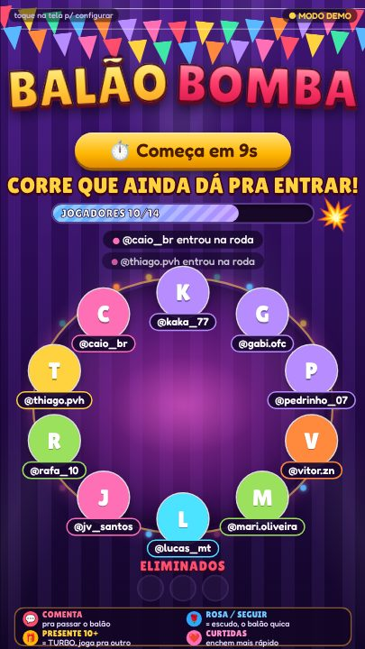
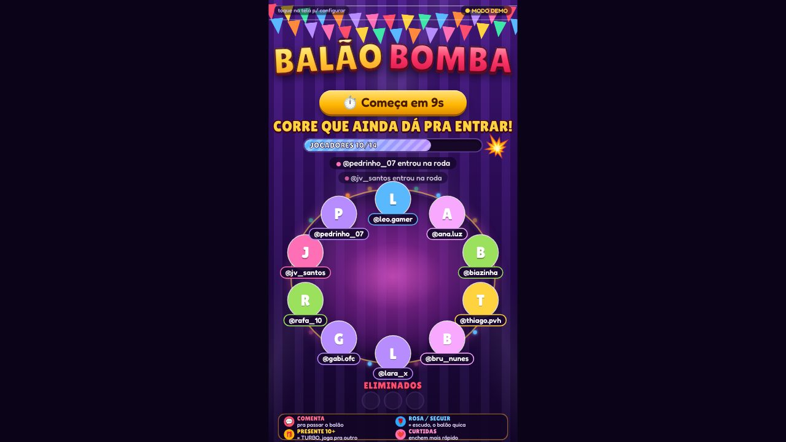

# Balão Bomba — jogo automático para lives do TikTok

Jogo de batata quente que roda sozinho durante a live. Quem comenta entra na roda, o balão passa de mão em mão e estoura num tempo aleatório. A plateia interfere em tempo real com comentários, curtidas, rosas, follows e presentes.

**[Abrir a demo](https://kenzokishi.github.io/balao-bomba/)** — abre em modo demo, com jogadores simulados.

## Como a plateia joga

| Ação na live | Efeito no jogo |
| --- | --- |
| Comentar | Entra na roda ou passa o balão |
| Rosa ou seguir | Ganha um escudo, e o balão quica de volta |
| Curtidas | Enchem o balão mais rápido |
| Presente de 10 moedas ou mais | Modo turbo: joga o balão para outro jogador |

## Como funciona

- Recebe os eventos da live pelo WebSocket do **TikFinity** (`ws://localhost:21213`) e entra no **TikTok LIVE Studio** como fonte de navegador.
- Funciona tanto em tela vertical quanto horizontal. Tem lobby com mínimo e máximo de jogadores, tempo de estouro aleatório, entrada atrasada, som e palavra-chave para entrar. Tudo é configurável tocando na tela ou pela URL (`?max=14&ws=...`).
- O modo demo simula a plateia para testar sem estar ao vivo.
- HTML, CSS e JavaScript puros num arquivo só. As configurações ficam salvas no navegador.

